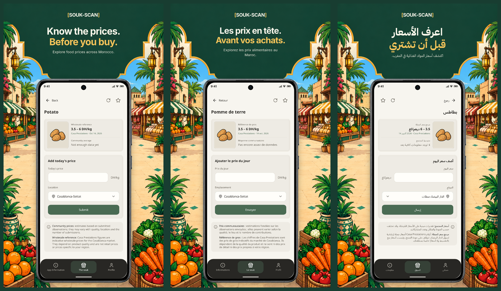

# SOUK-SCAN — realistic phone mockups

The twelve 1080 × 1920 phone graphics now use a photorealistic, front-facing graphite Android handset mockup. Its hardware frame includes a slim bezel, rounded glass, centered camera, earpiece and side keys. The app screen is clipped precisely inside the display at its native aspect ratio, with a separate status bar and bottom gesture bar. There is no rotation, stretching or fake thick drawn border.

The campaign's existing arch remains the sole title area, with no added title panel. All three approved 1024 × 500 feature images are preserved byte for byte. The shared 512 × 512 icon is unchanged.

Every 01-market.png continues to show the current product page with wholesale reference and the complete blank price-entry form. All app captures were refreshed at 390 × 830 CSS pixels (3× capture density) to fit the handset display without distorting the interface. The other images show fruit browsing, regional choice and favorites. Phone hardware and the sample operating-system status chrome are promotional mockup elements, not a physical-device capture.

The product form was rendered from unchanged version 1.1.0 React code in an isolated screenshot session using the repository's local authentication fixture and an empty observation response for that fixture identity. Price data came from real public read-only requests. No real user account was accessed or created, no private observations were retrieved and no price was submitted. Other captures use the existing read-only preview with its external development banner cropped out. Original source dates and insufficient community data remain visible.

Upload graphics are under graphics/en, graphics/fr and graphics/ar. Each locale contains four phone images plus the approved feature image. graphics/icon-512.png is shared. validation.json contains dimensions, file sizes and RGB channels. All outputs are within the user's upload limits. layout-checks.json checks that text stays inside the existing header and above the phone.

Editable layout, fonts and the generated handset are under design/. Raw captures are retained for reproducibility. No application code, website deployment or Play Console entry was modified.


## Files and preview

- [Download the complete upload pack](souk-scan-play-store.zip).
- Phone screenshots and feature graphics: [English](graphics/en/), [French](graphics/fr/), [Arabic](graphics/ar/).
- [Shared app icon](graphics/icon-512.png).
- [All 12 phone graphics](all-screens-preview.png) and [product-entry comparison](product-entry-preview.png).
- [Validation manifest](validation.json) and [layout measurements](layout-checks.json).



## Re-render

From the repository root, install the existing dependencies with `npm ci`.
Serve this asset folder in a terminal:

```sh
python3 -m http.server 5184 --directory docs/store-graphics/v1.1.0
```

In another terminal, render the 12 phone graphics:

```sh
node docs/store-graphics/v1.1.0/design/render.cjs
```

The renderer uses the repository's Playwright dependency and `/usr/bin/chromium`.
Change that browser path if Chromium is installed elsewhere. Fonts and artwork
are local and the raw screenshots are already supplied; rendering does not
sign in or query a backend. The approved feature images are not re-rendered.
After rendering, normalize outputs to opaque RGB PNGs and revalidate file sizes
before uploading. The saved upload files and ZIP are already validated.
